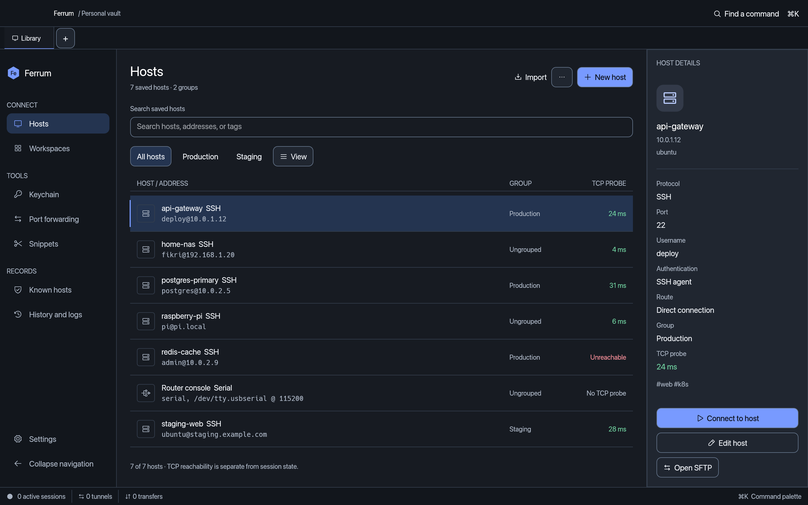
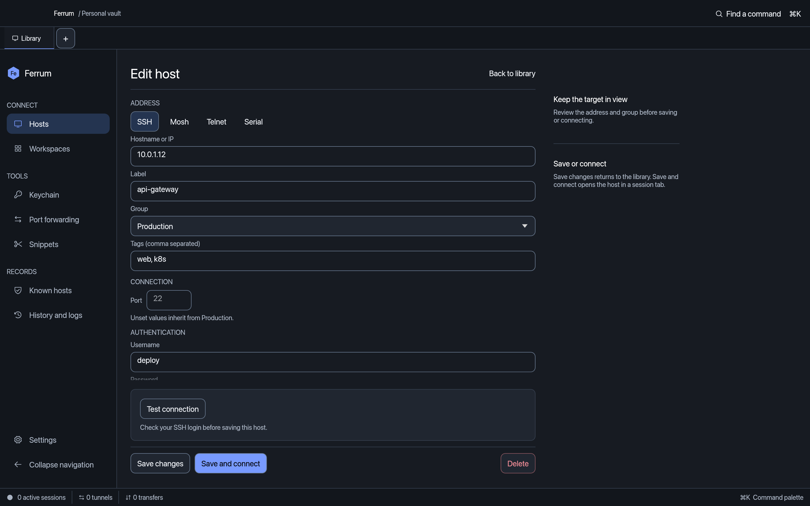
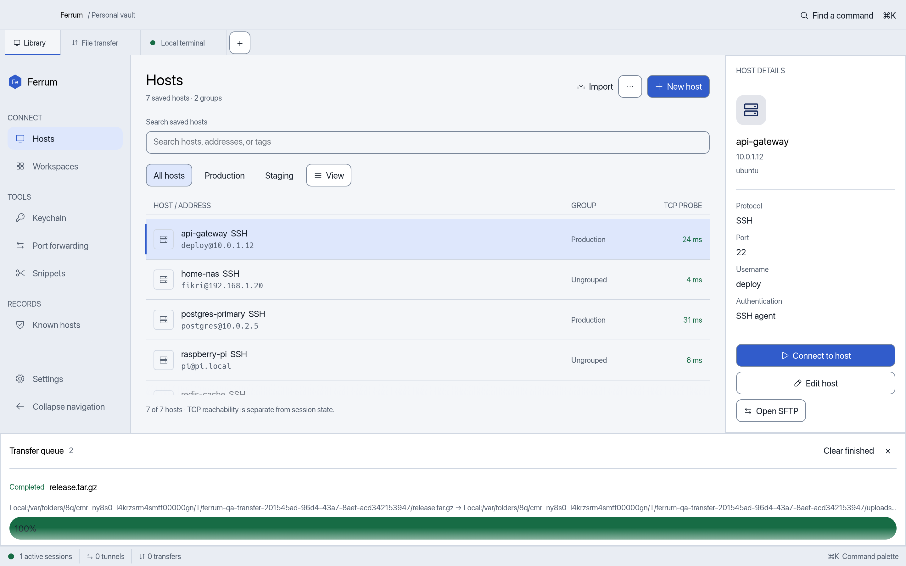
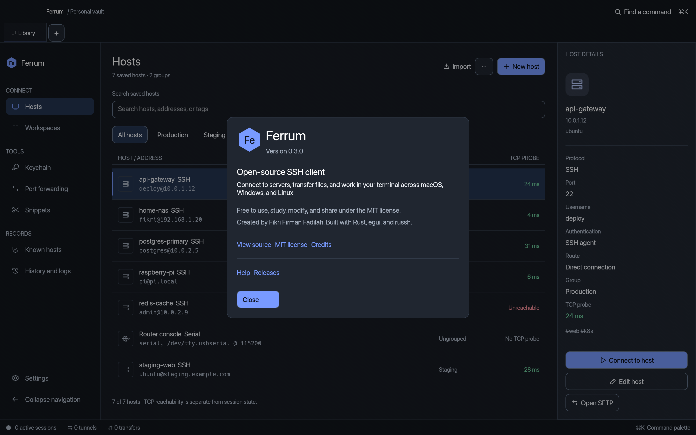

# Ferrum

An open-source SSH and SFTP client for macOS, Windows, and Linux, built in Rust. Free to use and modify under the [MIT license](LICENSE).

[Releases](https://github.com/fikrifirmanf/ferrum-ssh/releases) · [Report an issue](https://github.com/fikrifirmanf/ferrum-ssh/issues) · [Build from source](#build)

## Screenshots

Captured from the running Workbench UI with demo hosts. No saved connections or credentials appear in these images.



| Host editor | Light theme |
| --- | --- |
|  |  |

<details>
<summary>About Ferrum</summary>



</details>

## Workbench interface

Select a host to inspect its address, login and route before connecting. Use Up/Down to select a row and Enter to connect. Search, group and tag filters work together. Quick connect is available from the command palette and the host actions menu.

Choose comfortable or compact rows in **View** or **Settings → Appearance**. Existing grid preferences remain available. Session tools share one panel, and small windows can switch between the two file locations.

## Features

- **Connections:** SSH, Mosh, Telnet, serial and a local shell, each in a tab. Panes split side by side, stacked or in a grid, with broadcast input to all panes and auto-reconnect.
- **Hosts:** groups with inherited settings, tags, pinning, search, and quick connect (`user@host:port`). Jump-host chains and SOCKS5 / HTTP / ProxyCommand proxies are supported. Each host can set a connect timeout and strict host-key checking.
- **SFTP:** a dual-pane browser for local ↔ remote and remote ↔ remote. It has a transfer queue with progress, cancel and retry, and you can rename, change permissions, delete, create files and folders, or edit a file in your own editor, chosen per file type (changes upload on save).
- **Port forwarding:** local, remote and dynamic (SOCKS). Rules can start automatically when you connect to a host.
- **Keychain:** generate ED25519, ECDSA or RSA keys, import existing ones, and install a public key on a server. Identities let many hosts share one login, and the SSH agent works too.
- **Snippets:** reusable commands with `{{variables}}`, filed in packages (folders), each with an optional global hotkey. Run them in one terminal or several at once.
- **Workspaces:** save the open tabs, splits and hosts under a name and reopen them together. Tabs can also be duplicated.
- **Known hosts:** the app warns you when a server's key changes, and can import `~/.ssh/known_hosts`.
- **History and logs:** a searchable command history, a connection log, and optional session recordings.
- **Containers:** a side panel for SSH tabs that lists Docker and Podman containers and Kubernetes pods by calling the CLIs already on the server. Start, stop or restart a container, read its recent logs, or type a shell command (`docker exec -it … sh`) into the terminal for you to run.
- **Import:** OpenSSH config, PuTTY, MobaXterm, SecureCRT and CSV, plus cloud hosts from DigitalOcean, AWS EC2 and Azure.
- **Vault:** stored on disk, optionally encrypted with a master password (Argon2id + ChaCha20-Poly1305). It auto-locks when idle and supports encrypted export/import and folder sync. On macOS, Touch ID can unlock a master-password vault (Settings → Security); the password is kept in the login keychain behind the Touch ID prompt.
- **Appearance:** dark, midnight and light themes, accent colours, 18 terminal colour schemes, custom fonts and keyword highlighting.
- **Suggestions:** as you type in a terminal, grey ghost text offers a command from this host's history, other history, your snippets, then a built-in list of about 500 common commands (git, docker, kubectl, systemctl, apt and more). Press → to accept. It pauses after Tab, ↑ or cursor moves, and never records or offers anything typed at a password prompt. Turn it off in Settings → Terminal.
- **Server health:** a side panel in any SSH terminal shows live CPU, memory, swap, disks, uptime, load and the busiest processes, read over the same connection every 3 seconds. Linux reports everything; macOS and BSD report load, disks and processes. The host library shows TCP probe results separately from authenticated session state. Direct hosts are checked once a minute while the vault is open; hosts behind a jump host or proxy are skipped. Turn the probes off in Settings → Connections.
- **Command palette** (⌘K / Ctrl+K) and an optional AI command assistant.

## Build

```sh
cargo run --release
```

On Linux, install the GUI headers first:

```sh
sudo apt install libxkbcommon-dev libgl1-mesa-dev libwayland-dev libx11-dev libgtk-3-dev
```

## macOS installation and signing

Install the latest release with:

```sh
curl -fsSL https://raw.githubusercontent.com/fikrifirmanf/ferrum-ssh/main/install.sh | sh
```

The script picks the Apple Silicon or Intel build, checks it against the release's `SHA256SUMS.txt`, and copies `Ferrum.app` into `/Applications`. It asks for your password only if `/Applications` isn't writable. To install somewhere else, set `FERRUM_INSTALL_DIR`, for example `FERRUM_INSTALL_DIR=~/Applications`. Run the same command again to update.

Current macOS releases are ad-hoc signed, not notarized by Apple. Files downloaded with `curl` don't get the quarantine flag that triggers Gatekeeper, so the installed app opens normally.

If you download the DMG in a browser instead, macOS says “Apple could not verify Ferrum.” For a copy you trust, dismiss the alert, open **System Settings → Privacy & Security**, and choose **Open Anyway** for Ferrum. See [Apple’s instructions for opening an app from an unidentified developer](https://support.apple.com/en-us/102445).

Notarized macOS releases need a **Developer ID Application** certificate with its private key and Apple notarization credentials. The packaging script signs with hardened runtime and a secure timestamp, notarizes and staples the app, then signs, notarizes and staples the DMG. Gatekeeper must accept both before the build succeeds.

For local release packaging, import your certificate into Keychain Access, then store notarization credentials interactively:

```sh
xcrun notarytool store-credentials ferrum-notary
export MACOS_SIGNING_IDENTITY="Developer ID Application: $(security find-identity -v -p codesigning | sed -n 's/.*"Developer ID Application: \(.*\)"/\1/p' | head -1)"
export MACOS_NOTARY_PROFILE=ferrum-notary
sh packaging/build-macos.sh
```

Set `MACOS_SIGNING_IDENTITY` to the exact certificate name shown by `security find-identity -v -p codesigning`. A build without signing variables remains available for local development and prints a Gatekeeper warning. Set `MACOS_REQUIRE_NOTARIZATION=1` to require notarization.

For CircleCI, add these environment variables under **Project Settings → Environment Variables**. Use matching repository secrets for manual GitHub Actions builds.

| Variable | Value |
| --- | --- |
| `MACOS_CERTIFICATE_P12_BASE64` | Base64 of a P12 export containing the Developer ID Application certificate and private key. |
| `MACOS_CERTIFICATE_PASSWORD` | Password used to encrypt that P12 export. |
| `MACOS_SIGNING_IDENTITY` | Full `Developer ID Application: …` certificate name. |
| `APPLE_ID` | Apple developer account email. |
| `APPLE_TEAM_ID` | Apple developer team ID. |
| `APPLE_APP_SPECIFIC_PASSWORD` | App-specific password created for notarization. |

The CI wrapper imports the certificate into a temporary keychain and deletes it on exit. Without these variables, tagged CircleCI releases fall back to ad-hoc signed DMGs. Set `MACOS_REQUIRE_NOTARIZATION=1` in CircleCI to make missing credentials fail the release instead. Manual GitHub Actions packages always require notarization. Local builds can still produce ad-hoc packages for development. Never commit the P12 file or credentials. Replace existing downloads with the signed release.

## Tests

```sh
cargo test                       # unit tests
# End-to-end against a real SSH server (exec, SFTP round trip, local tunnel):
FERRUM_IT_SSH="user@127.0.0.1:2222" FERRUM_IT_KEY=~/.ssh/test_key \
  cargo test it_ -- --ignored --test-threads=1
```

CI (`.github/workflows/ci.yml`) runs both suites, starting a throwaway `sshd` for the integration tests, and builds release binaries on all three OSes.

## Visual QA

Debug builds can screenshot their own screens without screen-recording permission:

```sh
FERRUM_QA=home,sftp,settings,local,palette cargo run
# PNGs land in $TMPDIR/ferrum-qa (override with FERRUM_QA_DIR)
```

This mode adds demo data and never saves the vault. The steps `ssh`, `accept`, `type` and `sftpremote` use the live server from `FERRUM_IT_SSH` / `FERRUM_IT_KEY`.

## Credits

Ferrum is created by [Fikri Firman Fadilah](https://github.com/fikrifirmanf) and released under the [MIT license](LICENSE). It uses [egui](https://github.com/emilk/egui) for the interface, [russh](https://github.com/warp-tech/russh) for SSH, and [alacritty_terminal](https://github.com/alacritty/alacritty) for terminal emulation.

Icons are [Phosphor](https://phosphoricons.com) (MIT, `assets/fonts/PHOSPHOR-LICENSE.txt`). The UI palette is checked in tests for WCAG AA contrast in all three themes.

## Menus and updates

On macOS, File, Edit, View and Help live in the system menu bar. Windows and Linux show the same menus inside the window. Use Edit for Cut, Copy, Paste and Select all. Password inputs include a show/hide button.

Help → Ferrum help opens this page. Help → About Ferrum shows the installed version, author, MIT license, and source code links.

Ferrum checks public GitHub releases once after startup. When a newer release is available, a small notice offers **View update**, **Later**, and a close button. Dismissing it keeps the current session running and hides that release notice until the next launch. Downloads and installation always require your action. Disable startup checks in **Settings → Updates**; **Help → Check for updates** remains available for manual checks. Startup checks use the public release API without accessing saved GitHub credentials. Preview releases are optional for manual checks. For a private repository, Ferrum uses an existing GitHub CLI login, `GH_TOKEN` / `GITHUB_TOKEN`, or a token entered in the update dialog. Tokens entered there stay in memory until the app closes.

The updater selects a package for the current OS and CPU, checks its size and GitHub SHA-256 digest, then stages it before offering **Install and restart**. macOS additionally checks the app signature, bundle identifier and version. Restart saves the vault and closes terminal sessions. The old build is kept beside the installation as a hidden recovery copy. Installation errors leave a log in the `ferrum-update-*` temporary directory. AppImage and read-only installations can use the GitHub release page to install manually.

To publish an update, bump `package.version` in `Cargo.toml`, refresh `Cargo.lock`, and push the matching `v<version>` tag. GitHub Actions builds every platform, creates checksums, and publishes a GitHub Release after all builds succeed. If any job fails, CircleCI is triggered for the same tag as a fallback. The tag must match the package version.

## CircleCI

`.circleci/config.yml` is the release fallback. It no longer runs on a plain tag push. The `circleci-fallback` job in `.github/workflows/release.yml` starts it through the CircleCI API when a GitHub Actions release job fails on a `v*` tag. Add a CircleCI personal API token as the `CIRCLECI_TOKEN` repository secret in GitHub to enable this. Each tag runs format checks and unit tests, builds Linux, Windows and both macOS packages, then publishes a GitHub Release after all builds succeed.

Connect `fikrifirmanf/ferrum-ssh` in CircleCI and select the existing `.circleci/config.yml`. The macOS and Windows jobs need access to those CircleCI executors.

For automatic releases, add `GH_TOKEN` under **Project Settings → Environment Variables**. Use a fine-grained GitHub personal access token restricted to `fikrifirmanf/ferrum-ssh`, with **Contents: Read and write** permission. Give it an expiration date and rotate it before it expires. Keep it out of source files and build logs. GitHub Actions' release workflow is now a manual packaging fallback and does not publish releases.

After updating the version in `Cargo.toml` and refreshing `Cargo.lock`, commit and push `main`, then create and push the matching tag. For version `0.1.1`:

```sh
git tag -a v0.1.1 -m "Ferrum v0.1.1"
git push origin v0.1.1
```

The publisher checks that the GitHub tag points to the exact commit CircleCI built. It requires every installer, verifies the uploaded digests, and publishes only after all files are present. Failed uploads leave a draft for a retry. Published releases are never overwritten; an identical retry succeeds without changes. Tags such as `v0.2.0-beta.1` are published as preview releases.

Push the matching version tag to start the release workflow. Ordinary commits and merges do not start CircleCI jobs.

To test the release helper locally, run `python3 -m unittest discover -s packaging -p 'test_*.py' -v`.

For interactive visual checks with disposable demo data, run `FERRUM_QA=interactive cargo run`. This mode keeps the window open and does not save the vault.
